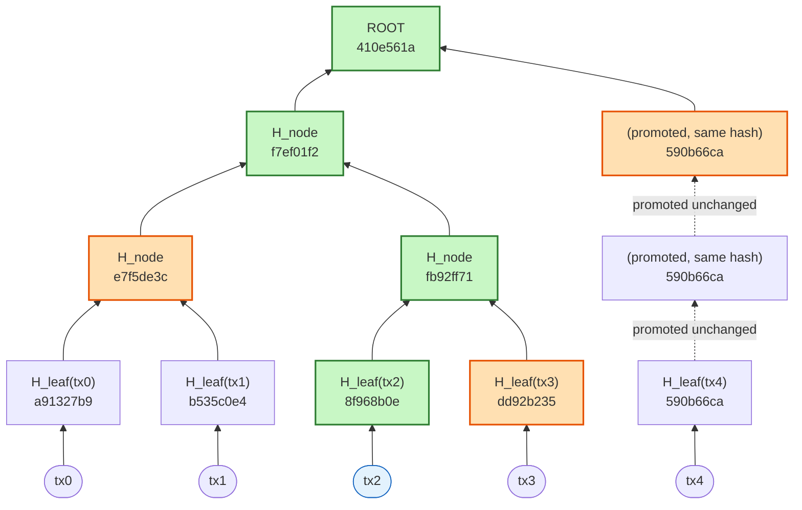

# Proof path diagram — 5 transactions

Generated by `merkle diagram --index 2`. GitHub renders the Mermaid block below as a graph.

Tree for `tx0 … tx4` using `H_leaf = SHA256(0x00||data)` and `H_node = SHA256(0x01||L||R)`. With 5 leaves the last leaf, `tx4`, has no partner on levels 0 and 1, so it is **promoted unchanged** (dotted edges), not duplicated.



Proof for **tx2** in a tree of **5** transactions (green = recomputed path, orange = siblings supplied by the proof):

1. `h = H(0x00 || "tx2")` = `8f968b0e4dc16ea8…`
2. sibling on the **right** `dd92b2355c6a1ab7…` → `h = H(0x01 || h || sibling)`
3. sibling on the **left** `e7f5de3cc43cc9ff…` → `h = H(0x01 || sibling || h)`
4. sibling on the **right** `590b66ca74e47297…` → `h = H(0x01 || h || sibling)`
5. compare `h` with the root `410e561afb28190ea4a953dc541c5ee3965b9abc09724adfe1467fd55dfc1949` ✔


### ASCII view

```
                         ROOT = H(0x01 || N0123 || L4)
                        /                          \
             N0123 = H(01||N01||N23)                L4 (promoted twice)
             /                 \                     :
   [N01] = H(01||L0||L1)     N23 = H(01||L2||L3)     L4 (promoted)
      /      \                /        \             :
    L0        L1           *L2*       [L3]          [L4]
    |         |              |          |             |
   tx0       tx1           tx2        tx3           tx4

  *L2*  = leaf being proven          [..] = siblings in the proof
  proof(tx2) = [ right: L3, left: N01, right: L4 ]   (3 hashes = 96 raw bytes)
```
