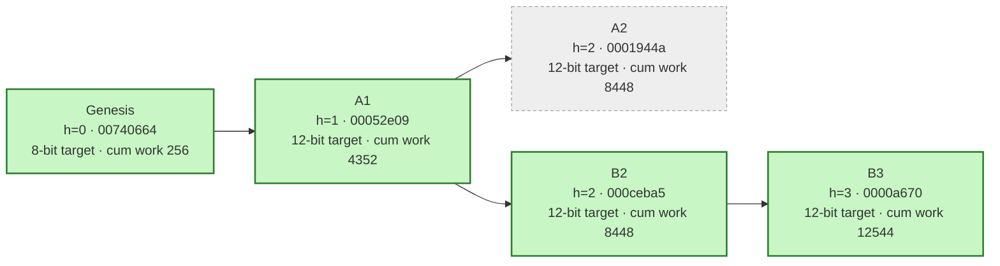
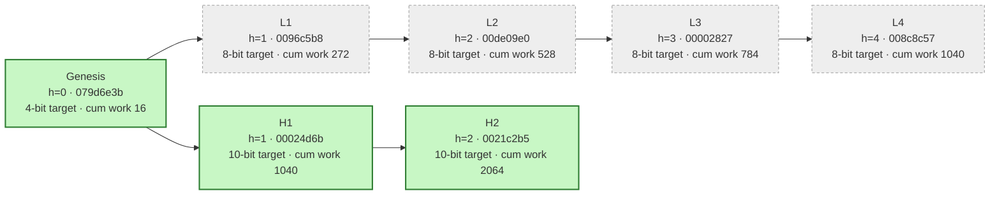

# Blocks, Proof of Work, forks and reorganisation — report

Generated by `python -m chain demo`. Hashes and nonces change between runs because signatures and benchmark headers are randomised; the structure and outcomes are asserted by the code.

## 1. Two miners produce competing blocks, then the fork resolves

- MinerA mines **A1** (height 1, 278 attempts); both nodes accept it: A=connected, B=connected
- Alice double-spends her genesis output: tx `9a02c2c5ee` pays Bob 30 (seen by MinerA) and tx `87fa0e426b` pays Carol 40 (seen by MinerB)
- Both mine height 2 at the same time: **A2** `0001944a68` (Bob paid) and **B2** `000ceba5f4` (Carol paid); each node connects its own: A=connected, B=connected
- Blocks are exchanged. Equal work, so each node keeps its first-seen tip: A gets B2 → **side-branch**, B gets A2 → **side-branch**
- Temporary disagreement: nodeA tip 0001944a68 (Alice=19, Bob=30, Carol=0, MinerA=101, MinerB=0); nodeB tip 000ceba5f4 (Alice=8, Bob=0, Carol=40, MinerA=50, MinerB=52)
- MinerB extends its branch with **B3**: nodeB connected; nodeA **reorg**: disconnected ['A2'], connected ['B2', 'B3']
- Transactions returned from the stale block A2: ['9a02c2c5ee']. Alice's genesis output was restored on disconnect and then spent by B2, so the Bob payment is now a conflict (it is rejected if re-validated: `missing-or-spent-input`)
- **Converged:** both tips = 0000a67079, height 3, UTXO state hash `d24e96f8d7d76b76…` on both nodes. Final balances: Alice=8, Bob=0, Carol=40, MinerA=50, MinerB=102
- A third node that only ever saw Genesis→A1→B2→B3 has the identical UTXO set ✔

Block tree as seen by nodeA (green = active chain, grey = stale branch):



## 2. A longer but lower-work branch loses to a shorter higher-work branch

- Branch **L** (4 blocks, 8-bit target, work 256 each) is active: height 4, cumulative work 1040
- Block **H1** (10-bit target, work 1024, cumulative 1040) → **side-branch** (equal work: first-seen tip kept)
- Block **H2** (10-bit target, work 1024, cumulative 2064) → **reorg**
- Result: active chain is the **2-block** branch H (cumulative work 2064) instead of the 4-block branch L (work 1040). A node that counted blocks would have kept L.



## 3. Invalid blocks are rejected without changing the active chain

| Block | Result | Reason |
|---|---|---|
| invalid PoW (hash > target) | **rejected** | bad-pow: hash 5bc81151f7997439… > target |
| incorrect Merkle root | **rejected** | bad-merkle-root: header merkle_root does not match transactions |
| excess coinbase value (subsidy + 1) | **rejected** | excess-coinbase: coinbase pays 51 > subsidy 50 + fees 0 (active chain unchanged) |
| contains an invalid transaction (double spend) | **rejected** | bad-tx: tx 5139169a9a: missing-or-spent-input: input 0 2e5898df75…:0 is not unspent (active chain unchanged) |
| heavier fork block (20-bit target) with a missing input | **rejected** | bad-tx: tx 86863d2ea8: missing-or-spent-input: input 0 4242424242…:0 is not unspent (active chain unchanged) |

After all five, the active tip is still `0000a67079` and the UTXO state hash is unchanged ✔

The honest block `000e47a22c` with the same parent is then accepted: **connected**.

## 4. Block header hex dump (block B3 of the fork simulation)

```
offset  field        bytes (hex)                                                       meaning
     0  version      00000001                                                          u32 = 1
     4  prev_hash    000ceba5f4ffcdde63477fdaaaed84088cbdfb3d778931d1549113ef613de3d6  parent block hash
    36  merkle_root  58a5828eee2959aa29b1c6c6dc064c0377d95af99e8f67dec870a99ebc554b33  Merkle root of txids
    68  timestamp    000000006553f808                                                  u64 = 1700001800
    76  target       000fffffffffffffffffffffffffffffffffffffffffffffffffffffffffffff  = 2^244 - 1
   108  nonce        0000000000000655                                                  u64 = 1621

raw header (116 bytes):
0000  00 00 00 01 00 0c eb a5 f4 ff cd de 63 47 7f da
0010  aa ed 84 08 8c bd fb 3d 77 89 31 d1 54 91 13 ef
0020  61 3d e3 d6 58 a5 82 8e ee 29 59 aa 29 b1 c6 c6
0030  dc 06 4c 03 77 d9 5a f9 9e 8f 67 de c8 70 a9 9e
0040  bc 55 4b 33 00 00 00 00 65 53 f8 08 00 0f ff ff
0050  ff ff ff ff ff ff ff ff ff ff ff ff ff ff ff ff
0060  ff ff ff ff ff ff ff ff ff ff ff ff 00 00 00 00
0070  00 00 06 55                                    

SHA-256(header) = 0000a67079ac1bd804e878b4f811689327027c1efcd118afc8174bcb342792f3
target          = 000fffffffffffffffffffffffffffffffffffffffffffffffffffffffffffff
hash <= target  : True
```

## 5. Proof-of-Work measurements

Machine: `x86_64`, Python 3.13.18. Each sample mines a header with random `prev_hash` and `merkle_root`, starting from nonce 0.

| Target | Expected attempts 2^256/(T+1) | Blocks mined | Mean observed attempts | Observed / expected | Median | Hashes per second |
|---|---:|---:|---:|---:|---:|---:|
| 8 leading zero bits | 256 | 500 | 252 | 0.99 | 188 | 2,293,217 |
| 12 leading zero bits | 4,096 | 200 | 3,896 | 0.95 | 2,447 | 2,331,272 |
| 16 leading zero bits | 65,536 | 60 | 69,144 | 1.06 | 45,912 | 2,311,320 |

Finding a block is a geometric trial with success probability p = (T+1)/2^256, so the expected number of attempts is 1/p = 2^256/(T+1). That is exactly the *work* the chain credits to the block. The observed means sit close to expectation (ratios near 1.0, with sampling noise from the geometric distribution's large variance: the standard deviation is about the mean, and the median is about ln 2 ≈ 0.69 of the mean). The hash rate is constant across targets, so each extra zero bit doubles the expected time to find a block.

