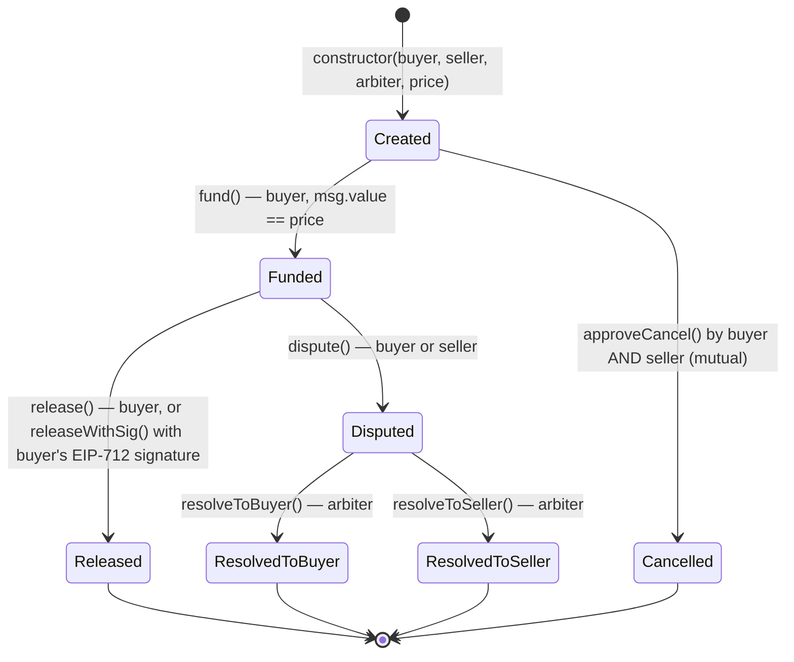

# Escrow — specification (written before the Solidity)

## Parties and parameters

| Item | Rule |
|---|---|
| `buyer`, `seller`, `arbiter` | fixed at deployment (`immutable`); none may be `address(0)`; all three must be **distinct** (an arbiter who is also a party is not neutral, and a buyer who is also the seller makes no sense) |
| `price` | fixed at deployment, in wei; must be `> 0` |
| Currency | native ETH only; plain transfers to the contract (`receive`/`fallback`) are rejected |

## States and permitted transitions



| State | Permitted transitions | Who | Effect on money |
|---|---|---|---|
| Created | → Funded | buyer, with exactly `price` wei | `escrowed = price` |
| Created | → Cancelled | buyer and seller must **both** call `approveCancel()`; the second approval transitions | none (nothing deposited) |
| Funded | → Released | buyer (`release`), or anyone relaying the buyer's EIP-712 `Release` signature | `credit[seller] += escrowed; escrowed = 0` |
| Funded | → Disputed | buyer or seller | none |
| Disputed | → ResolvedToBuyer | arbiter | `credit[buyer] += escrowed; escrowed = 0` |
| Disputed | → ResolvedToSeller | arbiter | `credit[seller] += escrowed; escrowed = 0` |
| Released, ResolvedToBuyer, ResolvedToSeller, Cancelled | **none** (terminal) | — | — |

Every function not listed for the current state reverts with `InvalidState(current)`. Every caller
not listed reverts with `Unauthorized(caller)`.

## Payments (pull pattern)

Transitions never send ETH. They only **credit** a payee (`credit[payee]`). A payee calls
`withdraw()` to collect, which follows **checks–effects–interactions**: it reads the credit, reverts
with `NothingToWithdraw` if it is zero, zeroes the credit and reduces the liabilities, and **then**
sends with OpenZeppelin `Address.sendValue`. The function is also guarded by OpenZeppelin
`ReentrancyGuard`. A payee whose fallback reverts only blocks its own withdrawal, never another
party's or a state transition.

`withdraw()` does not change the escrow state, so it remains callable in terminal states. This is the
only way funds leave the contract.

## Accounting invariant

```
address(this).balance == escrowed + totalCredits        (≥ if someone force-sends ETH via selfdestruct)
```

`escrowed` is money held for the deal; `totalCredits` is money owed to payees. Each `Released` or
`Resolved*` transition moves `escrowed` into `totalCredits` exactly once, so a terminal state cannot
pay twice. Every path that receives funds (Funded) has a way out: release, or dispute followed by
resolution. Nothing is locked without an intended path, provided the arbiter is live. See the
threat model for an arbiter who disappears.

## Events

`Funded(buyer, amount)`, `CancelApproved(party)`, `Cancelled()`, `Released(by, seller, amount)`,
`Disputed(by)`, `Resolved(arbiter, payee, amount, toBuyer)`, `Withdrawn(payee, amount)`, and
`StateChanged(from, to)` on every transition.

## Custom errors

`ZeroAddress()`, `RoleOverlap()`, `ZeroPrice()`, `Unauthorized(address)`, `InvalidState(State)`,
`WrongAmount(uint256 sent, uint256 expected)`, `AlreadyApproved(address)`, `NothingToWithdraw()`,
`SignatureExpired(uint256 deadline)`, `InvalidSignature()`.

## Stretch goal implemented: EIP-712 gas-sponsored release

The buyer signs typed data `Release(address escrow, uint256 nonce, uint256 deadline)` off-chain. The
EIP-712 domain is `name="ToyEscrow", version="1", chainId, verifyingContract`. Anyone (for example a
relayer paying the gas) calls `releaseWithSig(deadline, v, r, s)`.

- **Trust:** only the buyer's signature can authorise the release. The relayer cannot change the
  payee (always the seller) or the amount (always `escrowed`), so a relayer can at worst *not*
  submit the signature.
- **Replay:** the domain binds the signature to this chain and this contract address. The `nonce`
  is consumed on use. The state also moves to `Released`, so even an identical signature cannot be
  used twice. `block.timestamp > deadline` rejects expired signatures; a strict comparison, never
  equality. OpenZeppelin `ECDSA.recover` rejects malleable high-`s` signatures.
- **New assumption:** a leaked or phished signature releases the funds until the deadline. Buyers
  should use short deadlines. The buyer can't revoke a signature on-chain except by moving the
  escrow to `Disputed` first (dispute and release are both from `Funded`).
