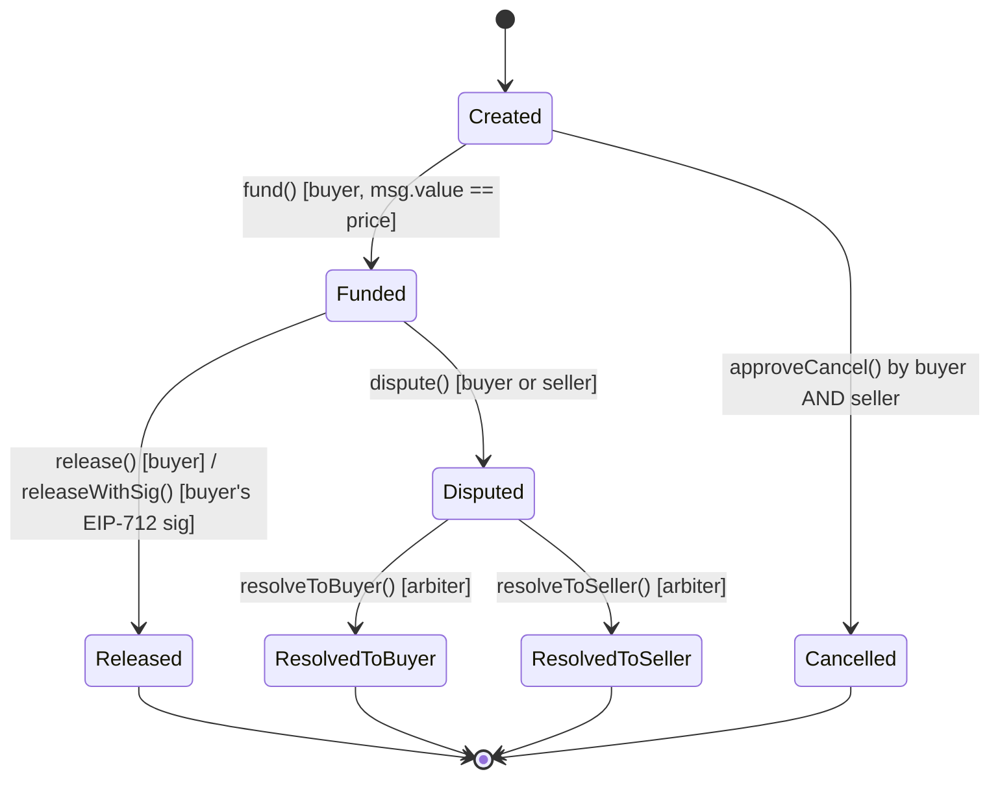

# Assignment 7 — Solidity Escrow from Specification to Deployment

 **Stack:** Solidity **0.8.28**, OpenZeppelin Contracts **5.4.0**, Foundry (forge, anvil, cast), forge-std 1.9.7

A three-party escrow (buyer, seller, arbiter) with an explicit state machine, access control,
events, custom errors, pull payments, unit, fuzz, and invariant tests, a scripted deployment to a
local Anvil node, a gas report, and a threat model. Stretch goal: EIP-712 gas-sponsored release.

## Layout

```
assign07/
├── readme.md
├── docs/specification.md     ← concise spec, written first, with the state-machine diagram (Mermaid)
├── docs/threat_model.md
├── src/Escrow.sol            ← the contract
├── test/Escrow.t.sol         ← unit tests for every transition and every rejected transition, fuzz tests
├── test/EscrowInvariant.t.sol← invariant tests: balance == liabilities, no double pay
├── script/Deploy.s.sol       ← deploy + interact (two deals, both payout paths), not a GUI
├── script/demo.sh            ← starts Anvil, broadcasts the script, verifies the result
├── script/verify_deployment.py ← checks receipts, events, balances, gas, bytecode and address
├── reports/deployment.md     ← verified local transaction receipts
├── reports/receipts.json     ← raw receipts (status, gas, logs)
├── reports/gas-report.md
├── foundry.toml
└── package.json / package-lock.json   ← reproducible dependency manifest (OpenZeppelin, forge-std)
```

## How to run

Prerequisites: [Foundry](https://book.getfoundry.sh/getting-started/installation) (`foundryup`),
Node.js 20+, and Python 3 for the deployment checker.

```bash
cd assign07
npm test                 # ONE command from a clean checkout: installs pinned deps (npm ci) and runs `forge test`
```

Other commands:

```bash
npm run gas              # forge test --gas-report
npm run coverage         # forge coverage (Escrow.sol: 100% branches)
./script/demo.sh         # Anvil deployment + interaction + verification → reports/deployment.md
```

## State machine



Terminal states allow no further state-changing transitions. Payees collect credited funds with
`withdraw()`, which follows checks–effects–interactions and is `nonReentrant`.

## Design highlights

- **Custom errors:** `Unauthorized(caller)`, `InvalidState(current)`, `WrongAmount(sent, expected)`, `ZeroAddress`, `RoleOverlap`, `ZeroPrice`, `AlreadyApproved`, `NothingToWithdraw`, `SignatureExpired`, `InvalidSignature`.
- **Events:** `StateChanged(from, to)` on every transition, plus `Funded`, `CancelApproved`, `Cancelled`, `Released`, `Disputed`, `Resolved`, and `Withdrawn`.
- **Pull payments:** transitions only credit; `withdraw()` sends. A reverting payee cannot block anyone else.
- **Prevented:** zero addresses, role overlap, repeated funding, wrong amounts, unauthorised transitions, reentrancy, and locked funds (every funded state has a path out). Plain ETH transfers are rejected.
- **Accounting:** `address(this).balance == escrowed + totalCredits`, asserted after every tested action and as a fuzzed invariant.
- **Pointers followed:** OpenZeppelin `ReentrancyGuard`, `Address`, `EIP712`, `ECDSA`; no `tx.origin`, no unbounded loops, no timestamp equality (`block.timestamp > deadline`), no unchecked low-level calls.

## Tests (37, all passing)

| Kind | What |
|---|---|
| Unit: every transition | fund, mutual cancel (both orders), release, releaseWithSig, dispute (buyer or seller), resolveToBuyer, resolveToSeller, withdraw, each with `expectEmit` checks on events, state, and balances |
| Unit: every rejected transition | `test_transitionMatrix_everyRejectedTransition` runs **all 168 combinations** of 7 states × 6 actions × 4 callers. A call succeeds iff the spec allows it, and a rejected call changes neither state nor funds. There are also targeted tests for each custom error |
| Security | reentrancy (hostile seller re-enters `withdraw`), rejecting payee, plain ETH rejected, forced ETH, no double pay, EIP-712 expiry, wrong signer, other-contract and wrong-nonce signatures, high-`s` malleability, and replay |
| Fuzz (1,000 runs each) | `testFuzz_depositAmounts` (price and sent amount), `testFuzz_callerRoles` (random caller vs every restricted function), `testFuzz_rolesAtConstruction`, `testFuzz_everyPathPaysExactlyOnce` |
| Invariant (256 runs × 50 calls) | balance == liabilities, credits sum correctly, the arbiter is never a payee, deposited == paid out + held, terminal states hold no escrow |

## Acceptance checks

| Requirement | Evidence |
|---|---|
| Balance and recorded liabilities agree after every tested action | `_accountingHolds()` after each action; `invariant_balanceEqualsLiabilities` |
| Unauthorised users cannot redirect funds | transition matrix, `testFuzz_callerRoles`, payees are not parameters |
| Terminal states cannot pay twice | `test_terminal_cannotPayTwice`, `testFuzz_everyPathPaysExactlyOnce`, `invariant_noDoublePay` |
| Full suite runs from a clean checkout with one documented command | `npm test` (`pretest` runs `npm ci` when `node_modules` is missing, then `forge test`) |
| Deploy to local Anvil and interact using a script | `script/demo.sh` → `forge script … --broadcast` |
| Verify events, final balances, gas used, deployed bytecode and address | `script/verify_deployment.py` → [`reports/deployment.md`](reports/deployment.md): all checks ✔ |

## Video demo

YouTube (unlisted): _to be added_
